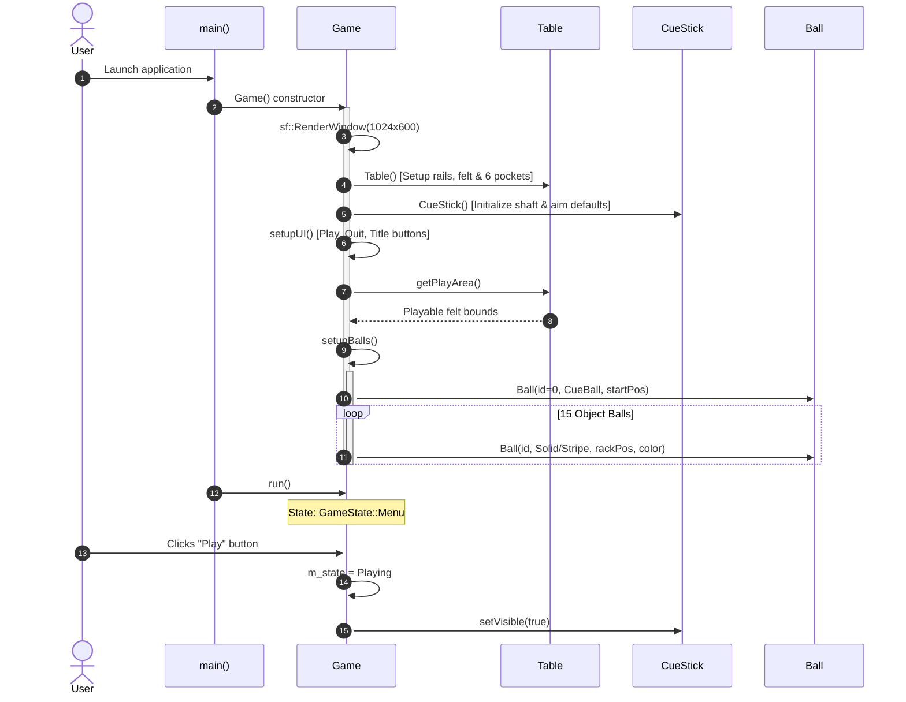
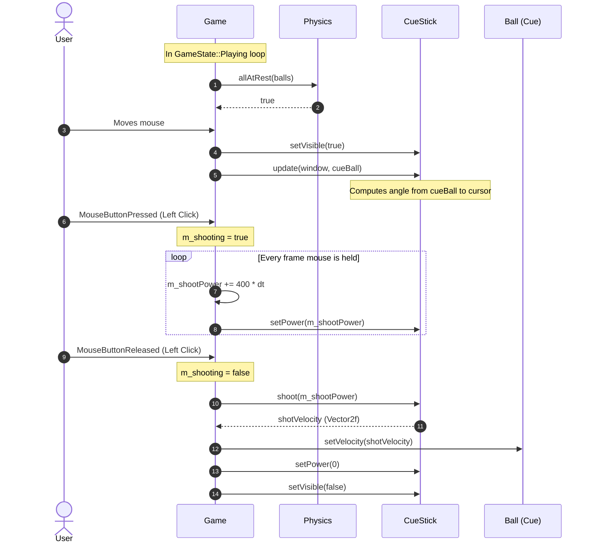
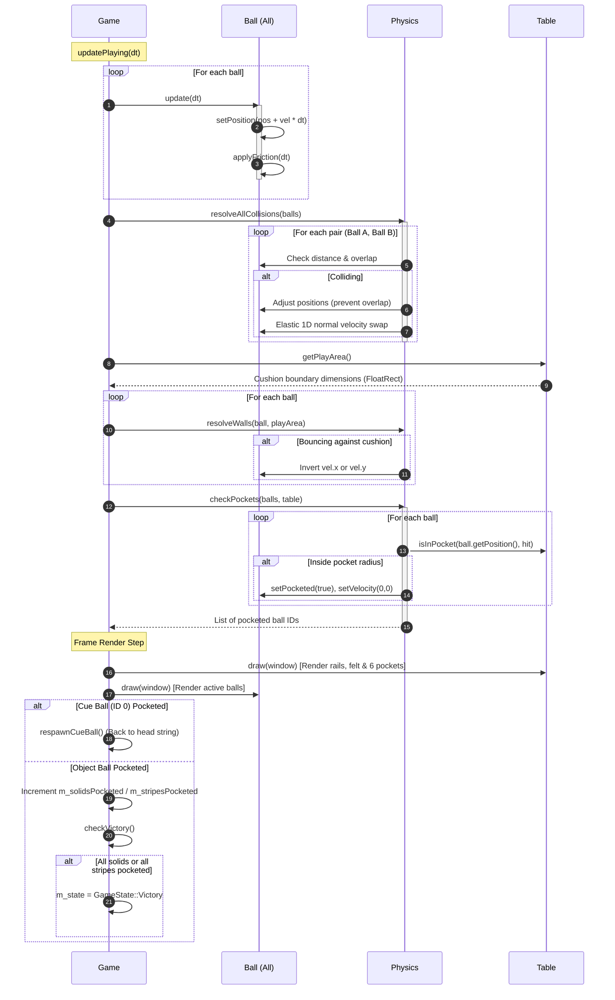
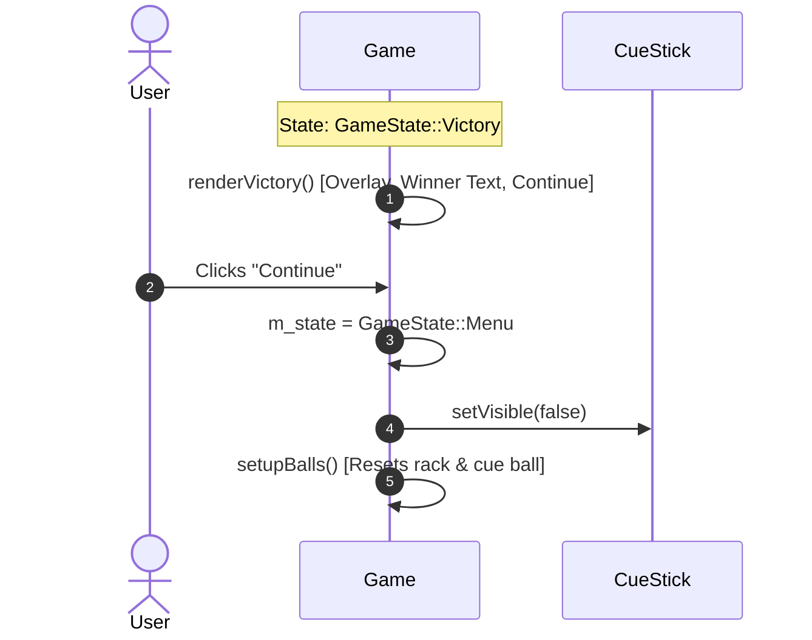

# 🎱 Billiards Architecture - Sequence Diagrams

This document illustrates the interactions between the 6 components:
1. `main`
2. `Game`
3. `Table`
4. `Ball`
5. `CueStick`
6. `Physics`

---

## 1. Initialization & Game Start

When the application boots up, `main` instantiates `Game`, which sets up the table, cue stick, and balls.

---

## 2. Aiming, Power Charge & Shooting (User Input)

When all balls are at rest, the cue stick tracks the mouse. Holding and releasing the left mouse button shoots the cue ball.

---

## 3. Physics Simulation & Pocketing Loop

Every frame while balls are in motion, velocities are updated, friction is applied, collisions are resolved, and pockets are inspected.

---

## 4. Victory Screen & Replay Loop

When the match concludes, the game transitions to the Victory state with a Continue button that restarts the cycle.

